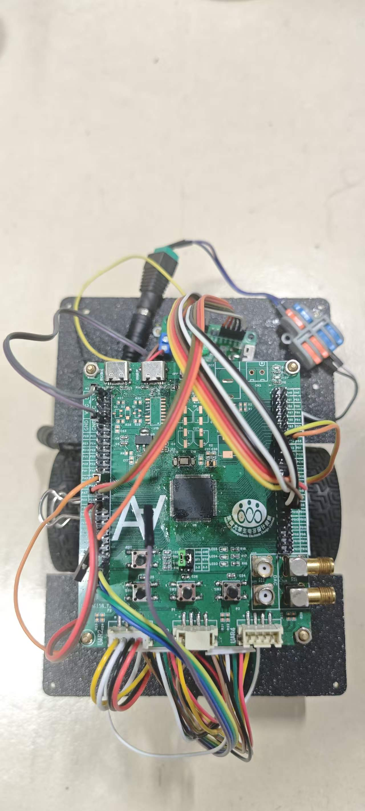
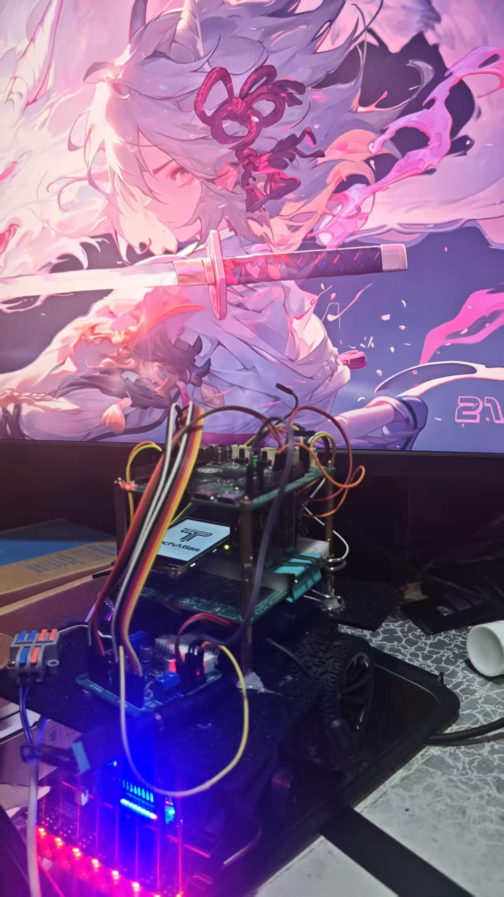
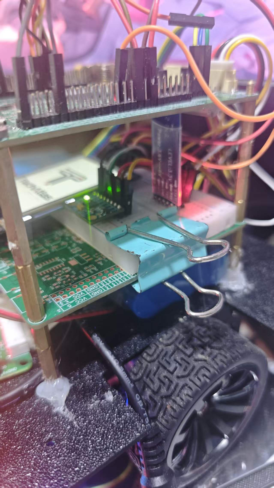

# Balance_Car — STM32 两轮自平衡循迹小车

基于 **STM32F103VET6** 的两轮自平衡车，站立、前进/后退、转向、循迹、丢线找回全在一颗 Cortex-M3 上完成。
控制策略为经典的**串级 PID**：直立环（内环）→ 速度环（外环）→ 转向/循迹（差速通道），所有环共用一个 200 Hz 的时基。

> 项目命名已统一为 `Balance`（早期版本误拼为 `Blance`，现已更正）。

---

## 实物与运行

| 俯视整车 | 侧视（示波器调参环境） | 传感器特写 |
| :---: | :---: | :---: |
|  |  |  |

运行视频：[vedio/balance_car.mp4](vedio/balance_car.mp4)

---

## 硬件配置

| 模块 | 型号/参数 | 接口 |
| :--- | :--- | :--- |
| MCU | STM32F103VET6（Cortex-M3，72 MHz） | HSE 12 MHz × PLL6 |
| IMU | MPU6050（±250 °/s，±2 g） | 软件 IIC1：PB14(SDA) / PB15(SCL) |
| 循迹 | 感为 8 路灰度传感器 | 软件 IIC2：PD3(SDA) / PD4(SCL)，地址 `0x4C` |
| 电机驱动 | 双路 H 桥 | TIM1 CH1(PA8) / CH2(PA9) PWM，AIN1/2 = PA10/PA11，BIN1/2 = PC8/PC9 |
| 编码器 | 正交编码器 ×2 | TIM3（PA6/PA7 左轮）、TIM8（PC6/PC7 右轮） |
| 显示屏 | ILI9341，240×320 SPI | SPI1（PB3/PB4/PB5）+ CS(PA15)/DC(PB0)/RST(PB1)，DMA 搬运 |
| 按键 | PE13，下降沿外部中断 | 200 ms 软件消抖 |
| 调试串口 | USART2，115200-8N1 | PA2(TX) / PA3(RX) |

外设时钟分配：`SYSCLK 72 MHz`、`APB1 36 MHz`、`APB2 72 MHz`；TIM1 PWM 频率约 **9 kHz**（72 MHz / 8 / 1000）。

---

## 控制架构

```
                      ┌──────────────────────────────────────────────┐
                      │                TIM6 中断 (5 ms, 200 Hz)      │
   MPU6050 ──IIC1──▶ │ 姿态融合(互补滤波) ─▶ 直立环 ─┐               │
                      │                              ├─▶ 差速分配 ─▶ PWM ─▶ 电机
   编码器×2 ───────▶ │ 速度环(10 ms 抽稀) ─▶ 平衡点偏移┘   ▲         │
                      │                              │   陀螺仪转向环  │
   灰度×8 ──IIC2──▶  │ 循迹环(15 ms 抽稀) ─▶ line_out ─┘               │
                      └──────────────────────────────────────────────┘
```

### 四个控制环

| 环 | 输入 → 输出 | 周期 | 作用 |
| :--- | :--- | :--- | :--- |
| 直立环 | 俯仰角 → 电机 PWM | 5 ms | 让车保持竖直，是唯一直接驱动电机的环 |
| 速度环 | 编码器速度 → **平衡点偏移量（°）** | 10 ms | 不直接给 PWM，而是平移直立环的目标角度实现前进/后退 |
| 转向环 | 偏航角速度 → 差速 PWM | 5 ms | 抑制不该有的自转（"别转"） |
| 循迹环 | 线位置(-7~+7) → 差速 PWM | 15 ms | 纠正跑偏（"别偏"） |

**差速通道是互斥的**：`pwm_L = angle + steering + line/lost + 编码器纠偏`，`pwm_R = angle - steering - line/lost - 编码器纠偏`。
同一时刻只有循迹环或丢线找线中的一方接管这条通道，否则两路输出会互相打架（见 `Core/Src/motor.c`）。

### 关键设计取舍

- **速度环输出的是"角度"而不是 PWM**。速度环只负责告诉直立环"我现在该往前倾还是往后倾多少度"，
  最终落地仍由直立环完成。这样即使速度环积分饱和，也不会直接打满电机，车不容易前冲。
- **速度指令必须先过斜坡再进速度环**（`motor.c: Line_SpeedUpdate()`）。目标速度阶跃会被速度环积分放大成一次前冲/后冲；
  加速慢、减速快、跨越前进↔倒车零点最快。
- **平衡点偏移带变化率限幅**（加偏 0.10°/拍、回收 0.20°/拍）。积分在堵转/停车时会攒到限幅，松手瞬间全量砸出会造成"顿"。
- **电机死区前馈**（`MOTOR_DEADZONE`）。减速电机静态摩擦需要一定占空比才起步，输出在零附近来回过零时每次都被摩擦"吃掉"，
  表现为轮子一顿一顿。
- **编码器速度反馈过死区 + 一阶低通**。静止时编码器只有 ±1 计数分辨率，噪声直接进速度环会被打进平衡点。
- **MPU6050 上电先原地校准 100 次**取陀螺零偏（`Calibration_100()`），未校准完之前 PID 完全不跑。

### 弯道速度规划（`Line_SpeedUpdate`）

中心附近保持全速，偏差越大目标速度越低，形成"慢进快出"：

- 静态降速：位置偏差 `>2` 触发，退出门限 `3`，**两者错开形成回差**——否则 pos 在门限附近抖动时目标速度在满速↔22%之间阶跃，砸进 `tilt_offset` 就是"速度不稳"。
- 动态降速：15 ms 内位置跳变 `>2` 格判定为"急入弯"，在静态降速基础上再乘 0.70，并给地板值 12%。

### 丢线找回状态机

```
STATE_TRACK ──丢线──▶ STATE_LOST ──重新看到线──▶ STATE_TRACK
                         │
                         └──(持续找线，不刹停、不倒车)
```

丢线时记录丢线瞬间线在哪一侧，然后**保持前进 + 朝线的一侧缓转**（"往线的位置走"，不是原地转向）。
转向量经斜坡渐入，避免瞬间满舵砸进平衡点。带 **100 ms 最短驻留**，挡掉丢线瞬间传感器边缘扫过的假信号
（否则一进 LOST 就被"看到线"打断，形成死循环）。

> `STATE_ESTOP` 的入口条件当前未接入（代码中只有出口逻辑），倒地保护需要自行补充：在 `Balance_PID()` 里判断 `|attitude.pitch|` 超过阈值即置 `STATE_ESTOP`。

---

## 目录结构

```
├── Core/
│   ├── Inc/  main.h（引脚宏）、motor.h、pid_demo.h、mpu6050.h、tracking.h、
│   │          lcd.h、iic.h、uart_vofa.h、gw_grayscale_sensor.h
│   └── Src/  main.c（时钟/中断入口/时基调度）
│              motor.c   ★ 状态机 + 平衡/速度/循迹调度 + 死区补偿
│              pid_demo.c ★ 位置式 PID 与四个闭环
│              mpu6050.c  姿态融合（互补滤波）+ 零偏校准
│              tracking.c 8 路灰度位置解算 + 丢线记忆
│              uart_vofa.c  VOFA 上位机通道 + 串口在线调参
│              usart.c     DMA+IDLE 接收、环形队列
│              lcd.c/ILI9341.c  LCD 驱动与 DMA 异步刷图
├── Drivers/    STM32F1 HAL + CMSIS
├── MDK-ARM/    Keil 工程（balance_car.uvprojx）
├── img/        实物照片与图片资源
└── vedio/      运行视频
```

---

## 编译与烧录

用 **Keil MDK 5** 打开 `MDK-ARM/balance_car.uvprojx`，选择 `STM32F103VET6`，直接编译。
编译器宏：`USE_HAL_DRIVER, STM32F103xE`。

调 `Core/Src/balance_car.ioc` 的硬件配置后，用 **STM32CubeMX** 重新生成代码即可
（本仓库 `.ioc` 与代码保持同步）。

固件已构建在 `MDK-ARM/balance_car/balance_car.hex`，可直接烧录。

---

## 使用说明

### 上电流程

1. 上电后 LCD 显示 `wating...`，串口打印 `[W]等待校准...`，此时 **MPU6050 正在采零偏，车不要动**。
2. 串口出现 `[W] 校准完成！` 后，LCD 转白底，车进入原地站立待机。
3. 按 **PE13 按键**（200 ms 消抖）启动：先站直，若循迹传感器在线则直接进入 `STATE_TRACK` 开始循迹。
4. 再按一次按键停车，各环积分清零，回到 `STATE_STAND`。

### 调参：串口在线改参数（不用重新烧录）

串口（115200）发送 `参数名=数值\n`（**必须带换行符**），参数即时生效。
这是本项目最主要的调参方式——`cmd_table`（`uart_vofa.c`）同时驱动 VOFA 上报和 LCD 显示，改一处即可：

| 命令 | 作用 | 当前默认值 |
| :--- | :--- | :--- |
| `PID_Upright_Kp` | 直立环比例 | -97.0 |
| `PID_Upright_Kd` | 直立环微分 | -6.0 |
| `L_PID_Speed_Kp` / `R_PID_Speed_Kp` | 左右速度环比例 | 0.08 |
| `L_PID_Speed_Ki` / `R_PID_Speed_Ki` | 左右速度环积分 | 0.002 |
| `L_PID_Speed_limit_i` / `R_PID_Speed_limit_i` | 左右速度环积分限幅 | 1000 |
| `PID_Turn_Kp` | 转向环比例 | 0.0（默认关闭） |
| `LinePID_Kp` | 循迹环比例 | -25.0 |
| `Speed` | 循迹目标速度（编码器计数/10 ms） | 24.0 |
| `Balance_Target` | 机械中值（平衡目标角度，°） | -5.4 |

把某个 Kp 置 0 即等于关闭该环（`pid_IsActive()` 的判定规则）。

### 调参：VOFA 波形

`Uart_Transmit_Task()` 每 20 ms 发一帧 **FireWater** 格式：`状态名:ch0,ch1,...\n`。

| 通道 | 含义 |
| :--- | :--- |
| ch0 | `tilt_offset` 平衡点偏移（°） |
| ch1 | `s_line_pos` 循迹位置 -7~+7 |
| ch2 | 丢线标志（1=丢线） |
| ch3 | `s_speed_cmd` 速度规划输出 |
| ch4 | `pwm_L` 左轮 PWM |
| ch5 | `pwm_R` 右轮 PWM |

VOFA 里选 FireWater 协议即可直接绘图。

### 调参顺序建议

1. **先纯平衡**：`LinePID_Kp=0` 关掉循迹，只让车站稳。调 `PID_Upright_Kp/Kd`。
2. **再直线**：保持 `PID_Turn_Kp=0`，给一个小 `Speed`，调速度环 Kp/Ki 让车匀速走直线。
3. **再转向**：逐步加 `PID_Turn_Kp`（0.5→1.0 起步），手拧车体验抗扭。
4. **最后循迹**：给 `LinePID_Kp`，先低速验证极性（线在右时 `s_line_pos` 应为正），再逐步提速。

### 调参注意事项（都是代码里踩过的坑）

- **`Balance_Target` 是"机械中值"**，不是当前俯仰角。改它会整体平移平衡点，车会持续往前/往后倒。
- **`PITCH_OFFSET`（mpu6050.c，默认 16.8°）与 `Balance_Target` 是两个量**：前者是传感器安装角误差，后者是控制目标角。装车后只调后者。
- **直立环 Kp/Kd 必须同号**（当前都为负）。error 已统一为 `target - current`，Kp 取负才是"倒下去向前救"；若把 Kd 单独改成正的，会变成正反馈，车会立刻飞掉。
- **速度环 `integral_separation` 必须为 0**。若设非 0，静止时 error=目标速度恒大于门限，积分被永久禁掉，导致"车不动→误差大→没积分→更不动"的死锁。
- **装车后若车往一侧跑偏或原地打转**，把 `STEER_ENC_KP` 改成负值（电机安装方向不匹配）。
- **循迹极性验证**：手持传感器让黑线在右侧，`s_line_pos` 应为正；若为负说明通道顺序装反，把 `tracking.c` 里 `kW[]` 全部取反。

---

## 已知限制

- `STATE_ESTOP` 目前只有出口没有入口，**没有倒地保护**。失控/倒地时电机不会自动停，调试时请远离车体、注意人身安全。
- 灰度判线依赖"最黑通道黑度 ≥ 170"（`LINE_BLACK_MIN`），换赛道材质/光照后需重新标定该阈值。
- 未接 RTOS，全部是裸机前后台（主循环 + TIM6 中断）；软件 IIC 的位延迟未做精确定标，换主频需重调。
- `Motor_Test_Set()` 仅在头文件中声明，尚未实现。

---

## 致谢

- `gw_grayscale_sensor.h` 来自感为智能科技（济南）的 8 路灰度传感器库。
- 姿态融合、PID 结构与调参思路参考江科大自协讲会的 STM32 平衡车教程。
